<a href="https://github.com/al8bright">한국어</a> · <b>English</b>

<picture>
  <source media="(prefers-color-scheme: dark)" srcset="assets/hero-dark.svg">
  
</picture>

I turn requirements into screens, and screens into systems that run.
After building public-sector systems, ERP integrations and startup products, I now design, build and run the core internal systems at a dental implant manufacturer.

[Blog (Korean)](https://socialofpeach.com) · [About (Korean)](https://socialofpeach.com/about)

### How I work

- **Screens first.** I put early-stage requirements on screen quickly, then make decisions by actually using them.
- **I see things through, even solo.** By adopting LLM and AI automation tools early, I've taken several services from design to infrastructure setup on my own.
- **I build the company's core.** I built ordering, HR, security and AI systems in-house, cutting infrastructure costs and tightening security.

### Stack

**Interface** 

**Server** 

**Data** 

**AI & Infra** 

### Built at work

| Project | What it does |
|---|---|
| **Org chart visualization** | Interactive view that makes a complex organization readable at a glance |
| **Video calls & internal chat** | Real-time communication on in-house WebRTC and WebSocket modules, replacing a third-party solution |
| **AI legal assistant** | Real-time Q&A (RAG) grounded in case law and legal data, built on Gemini and Vertex AI |
| **SSO** | Single OAuth2 sign-on across the company's web services |
| **Proxmox infrastructure** | Virtualized environment, Nginx Proxy Manager, server redundancy and backups |

### Open source

| Project | What it does |
|---|---|
| [**Social of Peach**](https://socialofpeach.com) | Personal dev blog (Korean). Posts, tags, comments, dark mode and SEO, all built from scratch |
| [flask-starter](https://github.com/al8bright/flask-starter) | One command generates a Flask + PostgreSQL project with login, admin screens, notices, DB migrations and CI. [Project site (Korean)](https://flask.socialofpeach.com) |
| [fastapi-svelte-pg-starter](https://github.com/al8bright/fastapi-svelte-pg-starter) | FastAPI + SvelteKit + PostgreSQL starter |
| [fastapi-nuxt-pg-starter](https://github.com/al8bright/fastapi-nuxt-pg-starter) | FastAPI + Nuxt + PostgreSQL starter |
| [hermes-slack](https://github.com/al8bright/hermes-slack) | A virtual dev team of 10 AI agents with distinct roles, working on a Kanban board and talking in Slack |
| [video-converter](https://github.com/al8bright/video-converter) | Desktop video converter with NVIDIA CUDA / NVENC hardware acceleration |
| [audio-converter](https://github.com/al8bright/audio-converter) | Desktop app that shrinks MP3 files by lowering the bitrate |

<b>Experience</b>

 

| Period | Company | Role |
|---|---|---|
| 2021.07 – now | Dental implant manufacturer | Team Lead, Software Team |
| 2018.07 – 2021.07 | Public-sector SI company | Web Developer |
| 2015.12 – 2018.03 | Industrial equipment R&D company | Software Engineer, R&D Lab |
| 2012 – 2015 | Web agencies, e-commerce startup, IT services | Web Developer |

