<b>한국어</b> · <a href="https://github.com/al8bright/al8bright/blob/main/README.en.md">English</a>

<picture>
  <source media="(prefers-color-scheme: dark)" srcset="assets/hero-dark.svg">
  
</picture>

요구사항을 화면으로, 화면을 동작하는 시스템으로 옮기는 일을 합니다.
공공기관 시스템과 중견기업 ERP 연동, 스타트업 제품을 거쳐 지금은 임플란트 제조 기업에서 사내 핵심 시스템을 직접 설계하고 개발하고 운영합니다.

[블로그](https://socialofpeach.com) · [소개](https://socialofpeach.com/about)

### 일하는 방식

- **화면부터 만듭니다.** 아이디어 단계의 요구사항을 먼저 화면으로 띄워 놓고, 직접 만져 보며 결정합니다.
- **혼자서도 끝까지 갑니다.** LLM과 AI 자동화 도구를 일찍 들여와 여러 서비스를 설계부터 인프라 셋업까지 혼자 완주했습니다.
- **회사의 코어를 직접 짓습니다.** 주문 · 인사 · 보안 · AI 시스템을 직접 구축해 인프라 비용을 줄이고 보안을 강화했습니다.

### 스택

**화면** 

**서버** 

**데이터** 

**AI · 인프라** 

### 회사에서 만든 것

| 프로젝트 | 내용 |
|---|---|
| **조직도 시각화** | 복잡한 인사 구조를 한눈에 보는 인터랙티브 시각화 서비스 |
| **화상회의 · 사내 채팅** | WebRTC · WebSockets 모듈을 직접 구현해 외부 솔루션 의존을 없앤 실시간 커뮤니케이션 |
| **AI 법률 도우미** | Gemini · Vertex AI 기반, 판례와 법률 데이터를 근거로 답하는 실시간 질의응답(RAG) |
| **SSO 통합 인증** | 사내 여러 웹 서비스를 하나로 묶는 OAuth2 단일 인증 |
| **Proxmox 인프라** | 가상화 환경, Nginx Proxy Manager, 서버 이중화와 백업 체계 |

### 공개 프로젝트

| 프로젝트 | 내용 |
|---|---|
| [**소셜 오브 복숭아**](https://socialofpeach.com) | 개발 경험을 기록하는 개인 블로그. 글 · 태그 · 댓글 · 다크 모드 · SEO까지 직접 구현 |
| [fastapi-svelte-pg-starter](https://github.com/al8bright/fastapi-svelte-pg-starter) | FastAPI + SvelteKit + PostgreSQL 스타터 |
| [fastapi-nuxt-pg-starter](https://github.com/al8bright/fastapi-nuxt-pg-starter) | FastAPI + Nuxt + PostgreSQL 스타터 |
| [hermes-slack](https://github.com/al8bright/hermes-slack) | 역할 · 성향을 나눈 AI 10명이 Kanban으로 협업하고 Slack에서 대화하는 가상 개발팀 |
| [video-converter](https://github.com/al8bright/video-converter) | NVIDIA CUDA · NVENC 하드웨어 가속 영상 변환 데스크톱 앱 |
| [audio-converter](https://github.com/al8bright/audio-converter) | MP3 비트레이트를 낮춰 용량을 줄이는 데스크톱 앱 |

<b>경력</b>

 

| 기간 | 회사 | 역할 |
|---|---|---|
| 2021.07 – 현재 | 임플란트 제조 기업 | SW개발실 비즈니스앱팀 차장 · 팀장 |
| 2018.07 – 2021.07 | 공공 SI 전문 업체 | 사업본부 대리 · 웹 개발 |
| 2015.12 – 2018.03 | 설비 연구개발 업체 | 연구소 대리 · 소프트웨어 |
| 2012 – 2015 | 웹 에이전시 · 이커머스 스타트업 · IT 서비스 업체 | 웹 개발 |

